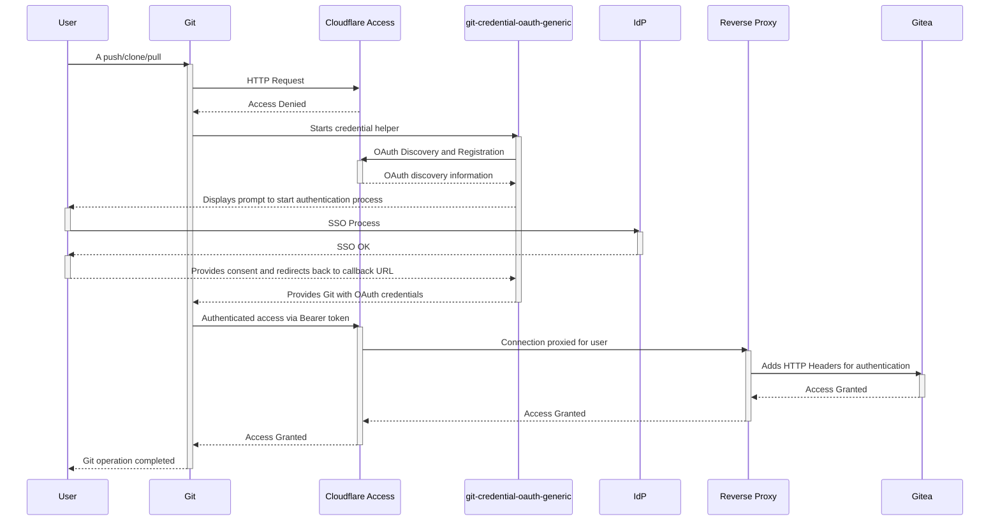

# git-credential-oauth-generic

[](https://codecov.io/gh/andrewheberle/git-credential-oauth-generic)

A Git credential helper that authenticates to any OAuth-protected Git host using
standard RFCs, with no hardcoded provider knowledge:

- **RFC 9728** - Protected Resource Metadata (discovery)
- **RFC 8414** - OAuth Authorization Server Metadata
- **RFC 7591** - Dynamic Client Registration
- **RFC 8707** - Resource Indicators (PKCE authorization code flow)

Originally developed for use with Cloudflare Access
[Managed OAuth](https://blog.cloudflare.com/managed-oauth-for-access/),
but should work with any authorization server implementing the above RFCs.

## Example Flow with Cloudflare Access



## Requirements

- **Git 2.45 or later** - this helper uses the `authtype` Bearer token credential
  format introduced in Git 2.45. Older versions of Git cannot send Bearer tokens
  and will not work with this helper. If the running Git version does not
  announce this capability, the helper prints an error and returns no credential,
  before contacting the host or opening a browser.

  On Ubuntu 24.04 LTS, the system Git may be older than 2.45. Upgrade via the
  official Git maintainers PPA:

  ```sh
  sudo add-apt-repository ppa:git-core/ppa
  sudo apt update
  sudo apt upgrade git
  ```

## How it works

1. Git invokes the helper with `protocol=https` and `host=<host>` on stdin. Requests
   for any other protocol (such as `http`), or without a host, are declined
   silently so Git can try the next credential helper
2. If a still-valid access token is cached for the host, it is returned to Git
   straight away, without any network requests
3. Otherwise the helper fetches `https://<host>/.well-known/oauth-protected-resource`
   (RFC 9728) to discover the authorization server. If the host has no such
   metadata (a 4xx, a page that isn't JSON, or no authorization server listed), it
   isn't an OAuth host and the request is declined silently. If the metadata can't
   be fetched (network error, timeout or server error), or names a different
   resource, the failure is reported
4. The AS metadata is fetched (RFC 8414) to obtain endpoints and supported scopes.
   For an issuer with a path (such as `https://idp.example.com/realms/x`) it is read
   from `https://idp.example.com/.well-known/oauth-authorization-server/realms/x`,
   falling back to OpenID Connect discovery at
   `https://idp.example.com/realms/x/.well-known/openid-configuration`. Metadata
   whose `issuer` doesn't match is rejected. Any failure at this step is reported
5. If a refresh token is cached and a `client_id` is configured, the helper refreshes
   the access token without opening the browser, sending the same `resource`
   parameter (RFC 8707) as the sign-in. If the authorization server rejects
   the refresh token (for example `invalid_grant`), it is discarded and the helper
   continues below. If the token endpoint can't be reached, times out or fails with a
   server error, the error is reported and the refresh token is kept, so the next Git
   operation tries again
6. If no `client_id` is cached in Git config, the helper registers dynamically
   (RFC 7591) and stores the resulting `client_id` in Git config. When the server
   supports public clients (`none` in `token_endpoint_auth_methods_supported`), the
   helper registers as one and no `client_secret` is needed. Otherwise any
   `client_secret` returned by the server is stored securely in the OS keyring
7. A PKCE authorization code flow is performed with a `resource` parameter (RFC 8707),
   opening the system browser and listening for the callback on localhost
8. The resulting Bearer token is returned to Git via the `authtype=Bearer` credential
   format

Requests to the host and authorization server (discovery, registration and token
refresh) time out after 30 seconds; the browser sign-in has 5 minutes.

During the browser sign-in, the page shown after the redirect reflects the real
outcome: it reports success only once the access token has been obtained. Callbacks
that don't belong to the sign-in in progress (for example from a stale browser tab)
are answered with an error page and ignored, so the current sign-in can still finish.

Token storage and refresh are save to the OS keyring by default or by a chained Git
credential storage helper (e.g. `git-credential-cache`).

## Installation

```sh
go install github.com/andrewheberle/git-credential-oauth-generic@latest
```

## Configuration

Configure the credential helper:

```sh
# Linux
git config --global --add credential.helper oauth-generic

# macOS (untested)
git config --global --add credential.helper oauth-generic

# Windows
# The Git Credential Manager (GCM) is enabled at a system level by default and must
# be disabled (see below for further information)
git config --global --add credential.helper ""
git config --global --add credential.helper oauth-generic
```

Configure as a chained credential helper (storage helper first, this helper second):

```sh
# Linux
git config --global --add credential.helper "cache --timeout 21600"
git config --global --add credential.helper "oauth-generic --nopersist"
```

On Windows the `wincred` and `manager` (GCM) helpers do not correctly store the
credentials output by `oauth-generic` based on testing so far.

With `--nopersist`, the storage helper keeps the access token and its refresh
token. When the access token expires, Git passes the stored refresh token to
`oauth-generic`, which uses it to get a new access token without opening the
browser. The new tokens are handed back to Git for the storage helper to keep.
This needs a storage helper that can hold Bearer credentials (Git's `authtype`
capability); of the helpers that ship with Git, only `cache` does. If the cache
entry has been evicted (for example after its `--timeout`), the next Git
operation signs in through the browser again.

### Callback port

The default callback port is `8400`, matching Cloudflare Access's expected
redirect URI pattern. To use a different port:

```sh
git config --global --add credential.helper "oauth-generic --port 9000"
```

## Credential storage

The dynamically registered `client_id`, and the redirect URI it was registered
with, are stored in Git config:

```
credential.https://git.example.com.oauthClientId
credential.https://git.example.com.oauthRedirectUri
```

If the callback port changes (see `--port`), the redirect URI no longer matches and
a new client is registered. A `client_id` set by hand has no redirect URI and is
never replaced.

The `client_secret`, if the server issues one, is stored securely in the OS keyring
(DBUS Secret Service on Linux, Keychain on macOS, Windows Credential Manager on
Windows) under the service name `git-credential-oauth-generic` with
`client:<client_id>:client_secret` as the account name. Secrets stored by earlier
versions under the resource URL are still read.

Without a usable OS keyring, a client that has no secret works normally. A client
that does have one can't be saved, so it is registered again on the next run.

Access tokens and refresh tokens are also stored in the OS keyring by default
but may be optionally stored by the chained storage helper by adding the
`--nopersist` option and are never written to disk by this helper directly.

## Verbose mode

```sh
git config --global --add credential.helper "oauth-generic --verbose"
```

Or test directly:

```sh
printf 'protocol=https\nhost=git.example.com\n' | git-credential-oauth-generic --verbose get
```

## Notes for Windows users

As noted above, on a default install of Git on Windows the Git Credential Manager
will not correctly store the returned credentials for subsequent git actions
(tested as of Git 2.54.0 with Git Credential Manager 2.7.3) so the options are:

1. Globally disable Git Credential Manager (as shown above)
2. Leave Git Credential Manager enabled but follow the below process to have only `oauth-generic` enabled:
   ```sh
   # Enable the generic OAuth credential manager
   git config --global --add credential.helper oauth-generic

   # Clone/pull to initially authenticate (cancel the GCM login prompt that appears)
   git clone https://git.example.com/user/test-repo.git

   # In your local repo disable all other credential helpers and enable oauth-generic
   cd test-repo
   git config --local --add credential.helper ""
   git config --local --add credential.helper oauth-generic
   ```
